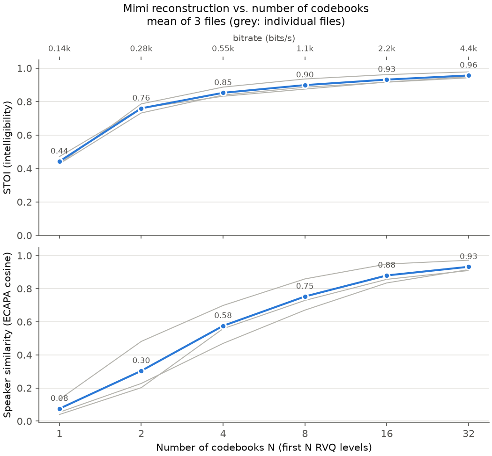

# codec-probing

What do the tokens of a pretrained neural audio codec encode? This project takes
Kyutai's **Mimi** codec (`kyutai/mimi`, 24 kHz, 12.5 frames/s, 32 residual
codebooks of 2048 entries) and measures how information is spread across its
residual vector quantization (RVQ) levels. No codec training is involved: only
pretrained models plus small linear probes. Everything runs on a CPU-only laptop.

| Phase | Question | Status |
|---|---|---|
| 1. Reconstruction | How do intelligibility and speaker identity recover as you add codebooks? | **done** |
| 2. Probing | Which levels linearly encode emotion, gender, speaker (vs. a WavLM baseline)? | planned |
| 3. Streaming | Live mic → encode → decode with an N slider and measured latency | planned |

## Setup

Python 3.11+ (developed on 3.13, Windows 11, CPU only).

```bash
python -m venv .venv
# Windows: .venv\Scripts\activate    macOS/Linux: source .venv/bin/activate
pip install torch==2.11.0 --index-url https://download.pytorch.org/whl/cpu   # CPU wheel
pip install -e ".[dev]"
```

The first run downloads Mimi (~370 MB, into the Hugging Face cache) and SpeechBrain's
ECAPA speaker model (~80 MB, into `outputs/pretrained/ecapa`).

## Phase 1: reconstruction vs. number of codebooks

For each input file and each N in {1, 2, 4, 8, 16, 32}, the sweep:

1. resamples the input to 24 kHz mono and encodes it with all 32 codebooks (cached),
2. decodes using only the first N codebooks and saves the WAV,
3. computes **bitrate** = 12.5 frames/s × N × 11 bits, **STOI** against the
   original, and **speaker similarity** (cosine of ECAPA embeddings, original vs.
   reconstruction),
4. writes `results.csv` and a two-panel plot.

### Run it

```bash
python scripts/fetch_examples.py      # 3 LibriSpeech clips -> data/examples/
python scripts/run_sweep.py           # uses configs/phase1.yaml
```

Everything is configurable in `configs/phase1.yaml`. CLI flags override the config:

```bash
python scripts/run_sweep.py --inputs path/to/clip.wav path/to/folder/ \
    --num-codebooks 1 2 3 4 8 32 --max-duration 10 --output-dir outputs/my_run
python scripts/run_sweep.py --no-cache -v   # force re-encoding, debug logging
```

Outputs (in `outputs/phase1/` by default; `outputs/` is gitignored):

| Path | Contents |
|---|---|
| `results.csv` | one row per (file, N): `bitrate_bps`, `stoi`, `speaker_similarity`, `decode_time_s`, path of the reconstruction |
| `stoi_speaker_vs_n.png` | STOI (top) and speaker similarity (bottom) vs. N; bitrate on the top axis |
| `audio/<name>_ref.wav` | the 24 kHz reference that metrics are computed against |
| `audio/<name>_nXX.wav` | reconstruction from the first XX codebooks; listen to these |
| `../cache/mimi_codes/*.npy` | cached codes (32 × frames), keyed by a hash of the audio |

The cache key is a hash of the audio samples plus the model id. Renaming a file still
hits the cache; changing the crop length re-encodes. One 32-level encode serves
every N because RVQ encoding is greedy: the first N codes of a 32-level encode are
identical to an N-level encode (verified in `tests/test_codec.py`). A rerun on cached
codes reproduces the metrics exactly.

### Results on the example clips

Three LibriSpeech read-speech clips (3 speakers, 14–17 s each), CPU:

| N | bitrate | STOI (mean) | speaker sim (mean) |
|---:|---:|---:|---:|
| 1 | 138 bps | 0.44 | 0.08 |
| 2 | 275 bps | 0.76 | 0.30 |
| 4 | 550 bps | 0.85 | 0.58 |
| 8 | 1.1 kbps | 0.90 | 0.75 |
| 16 | 2.2 kbps | 0.93 | 0.88 |
| 32 | 4.4 kbps | 0.96 | 0.93 |



### How to read the results

- **STOI** (0–1, higher is better) predicts how intelligible the reconstruction is
  relative to the original. It works at 10 kHz on short-time spectral envelopes, so it
  measures *intelligibility*, not fidelity: high STOI can still sound buzzy or
  "robotic". Use the WAVs to judge naturalness.
- **Speaker similarity** is the cosine between ECAPA-TDNN embeddings of the original
  and the reconstruction. It has no absolute scale, so compare it to these reference
  points measured on the same clips:
  - **different speakers** (original vs. original, across clips): **0.07–0.14**
  - **same speaker, different halves of one clip**: **0.79–0.89**

  A reconstruction near the first band has lost the voice. One near the second
  sounds about as much like the speaker as another sentence of theirs does.
- **The gap between the curves is the main finding.** With **one** codebook,
  intelligibility is already 0.44, yet speaker similarity (0.08) is no better than a
  different speaker. Codebook 0 is Mimi's *semantic* codebook, distilled from WavLM,
  and it carries content but essentially no voice identity. At **2 codebooks** STOI
  jumps to 0.76 while the voice is still mostly missing (0.30). Speaker identity
  accumulates slowly across the *acoustic* codebooks (1–31): it reaches the
  same-speaker band around N = 8–16, while STOI is flat after N ≈ 4. In other
  words, *what is said* is front-loaded and *who says it* is spread across the
  deeper levels.
- **Grey lines** are individual files and the blue line is their mean. With 3 clips
  this is a demonstration, not a statistically powered result.
- `decode_time_s` is offline, whole-file decode time on CPU (~1.1–1.8 s for 14–17 s
  of audio, roughly 10× faster than real time). It is not streaming latency; Phase 3
  measures that.

### Caveats

- The example clips are LibriSpeech (originally 16 kHz, distributed by librosa at
  22.05 kHz) upsampled to 24 kHz. They have no content above 8 kHz, so they are
  easier for the codec than true wideband audio. STOI is unaffected because it
  only scores up to 5 kHz.
- ECAPA is trained on VoxCeleb (16 kHz). Its embeddings may react to codec artifacts
  as well as to voice identity, so low-N similarity partly measures "sounds like a
  codec".
- Mimi decodes in frames of 1920 samples (80 ms). The output is trimmed or padded to
  the input length before scoring.

## Tests

```bash
pytest -q                   # ~15 s once models are cached; all on 2 s of synthetic audio
pytest -q -m "not model"    # skip tests that load pretrained weights
```

## Layout

```
configs/phase1.yaml          paths, N values, model ids, seed
src/codec_probing/
  codec.py                   MimiCodec: encode (all codebooks), decode(first N), disk cache
  metrics.py                 STOI, cosine similarity, ECAPA SpeakerEmbedder
  data.py                    loading, mono downmix, resampling to 24 kHz, synthetic test audio
  sweep.py                   Phase 1 loop, CSV writer, plot
  utils.py                   logging, seeding, config loading
scripts/run_sweep.py         Phase 1 CLI
scripts/fetch_examples.py    downloads the example clips
tests/                       pytest, 2 s synthetic audio
```

## Notes on the Mimi API (transformers 5.5.4)

- `MimiModel.encode(x[B, 1, T], num_quantizers=K).audio_codes` → `[B, K, frames]`;
  `MimiModel.decode(codes[B, K, frames]).audio_values` → `[B, 1, T]`, for any K ≤ 32.
- Codebook 0 is a separate 1-level semantic RVQ, and codebooks 1–31 are the acoustic
  RVQ. Both quantize the *same* encoder latent (a "split" RVQ), so codebook 1 is
  **not** a residual of codebook 0.
- Use `torch.no_grad()`, not `torch.inference_mode()`. The codebooks lazily cache
  their embedding tables on first use, and a table cached under inference mode makes
  every later grad-mode call fail.
